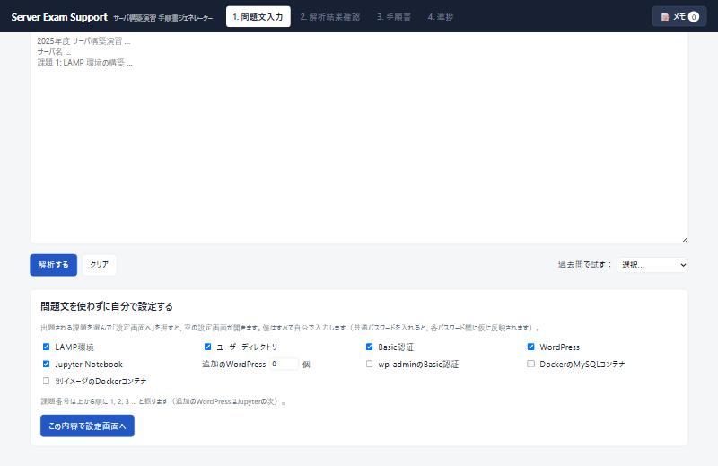
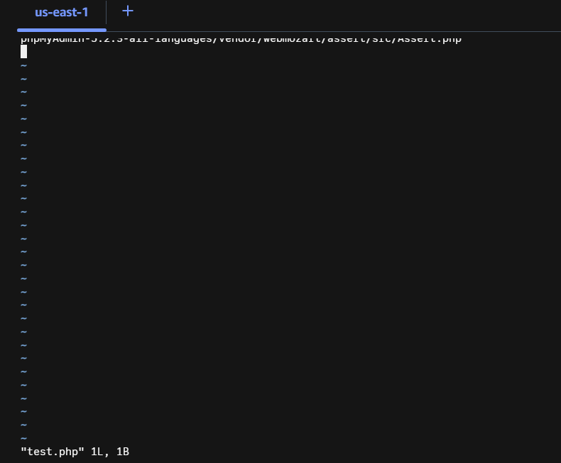
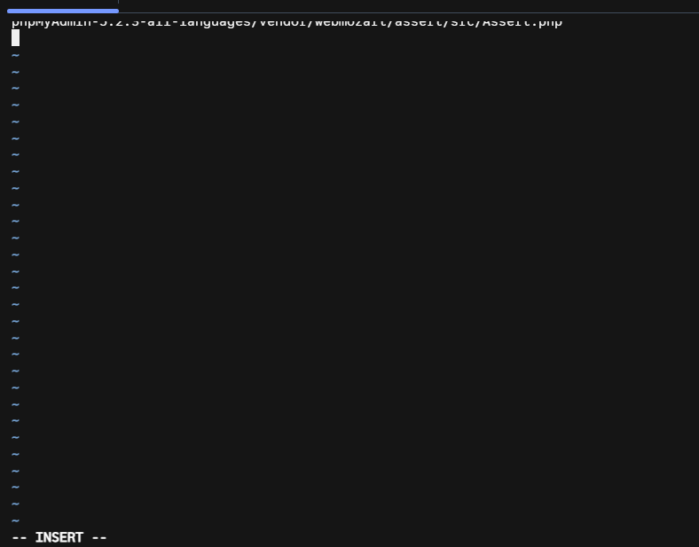

# Server Exam Support 説明書（はじめての人向け）

「サーバ構築演習」の試験問題を貼り付けると、**やることの順番（手順書）** と **コピーして使えるコマンド** を出してくれるツールです。
ここでは、Linux や AWS にまだ慣れていない人でも使えるように、1つずつ説明します。

> ⚠️ **最初に読んでください**
> - このツールを試験中に使ってよいかは、**担当の先生のルールに従ってください**。
> - コマンドは作者がふだん使っている手順（note記事）をもとにしています。**必ず自分の試験問題と見比べてから**実行してください。
> - このツールは「コマンドを表示・コピーする」だけです。サーバやAWSを勝手に操作することはありません。

---

## 目次

1. [まず知っておく言葉](#1-まず知っておく言葉)
2. [起動のしかた](#2-起動のしかた)
3. [使い方の流れ（全体）](#3-使い方の流れ全体)
4. [① 問題文を貼り付ける](#4--問題文を貼り付ける)
5. [② 解析結果を確認する](#5--解析結果を確認する)
6. [③ 手順書を見ながら作業する](#6--手順書を見ながら作業する)
7. [④ 進捗を確認する](#7--進捗を確認する)
8. [便利な機能](#8-便利な機能)
9. [よくある困りごと](#9-よくある困りごと)
10. [パスワードなどの扱い](#10-パスワードなどの扱い)

---

## 1. まず知っておく言葉

| 言葉 | 意味 |
|---|---|
| **ターミナル** | 文字でコンピュータに命令する黒い画面。AWS の「CloudShell」や Windows の「ターミナル」など |
| **コマンド** | ターミナルに打つ命令文。例：`sudo useradd taro`（taro というユーザーを作る） |
| **SSH（エスエスエイチ）** | 自分のPCから、AWS上のサーバにターミナルでつなぐ方法 |
| **パブリックDNS** | サーバの住所。`ec2-198-51-100-10.compute-1.amazonaws.com` のような長い名前。ブラウザで開くとサーバのページが見られる |
| **vi（ブイアイ）** | ターミナルの中でファイルを書き換える道具。最初は文字が打てないので注意（[後で説明](#vi-で文字が打てない)） |
| **sudo（スードゥ）** | 「管理者として実行する」という意味。コマンドの頭につける |
| **&&** | 「前のコマンドが成功したら、次のコマンドを実行する」という意味。いくつものコマンドをつなげて1回で実行できる |

---

## 2. 起動のしかた

### A. Webで使う（いちばん簡単）

公開されている URL をブラウザで開くだけです（公開されている場合）。

```
https://＜GitHubのユーザー名＞.github.io/server-exam-support/
```

### B. 自分のPCで使う（Windows）

1. このページ上の緑色の **「Code」ボタン → 「Download ZIP」** でダウンロード
2. ダウンロードした ZIP を右クリック → **「すべて展開」**
3. 展開したフォルダの中の **`start.bat`** をダブルクリック
4. ブラウザで `http://127.0.0.1:8755/` が開きます
5. 一緒に開く **黒い画面は閉じないでください**（閉じるとツールが止まります）。使い終わったら閉じてOK

> `start.bat` を使うには **Python** が必要です。入っていない場合は [python.org](https://www.python.org/downloads/) からインストールしてください（インストール時に「Add python.exe to PATH」にチェック）。
> `index.html` を直接ダブルクリックして開くと、データを読み込めず動きません。

---

## 3. 使い方の流れ（全体）

画面の上に 4 つのタブがあり、左から順に進めます。

```
1. 問題文入力  →  2. 解析結果確認  →  3. 手順書  →  4. 進捗
   問題を貼る       値をチェック        見ながら作業     どこまで終わったか
```

---

## 4. ① 問題文を貼り付ける



1. 試験問題の PDF を開き、**Ctrl + A（全部選択）→ Ctrl + C（コピー）**
2. ツールの大きな入力欄をクリックして **Ctrl + V（貼り付け）**
3. **「解析する」** を押す

### 問題文が無いとき・自分で入力したいとき

下の **「問題文を使わずに自分で設定する」** を使います。

1. 出題される課題にチェックを入れる（追加の WordPress がある場合は個数を入れる）
2. **「この内容で設定画面へ」** を押す
3. 次の画面で、ユーザー名やパスワードを自分で入力します

---

## 5. ② 解析結果を確認する

問題文から読み取った値（サーバ名、ユーザー名、パスワード、DB名 など）が一覧で表示されます。
各値の右に **状態** が出ます。

| 表示 | 意味 | どうする？ |
|---|---|---|
| 🟢 抽出済み | 問題文から読み取れた | 念のため問題文と見比べる |
| 🟡 要確認 | 読み取れたが自信がない／仮の値 | **問題文を見て、正しいか確認・修正** |
| 🔴 未設定 | 問題文に書いていない | **自分で入力**（入力しないとその値を使うコマンドはコピーできません） |
| 🔵 修正済み | 自分で書き換えた | — |

### ここでやること

1. **受験者情報** に **学籍番号** と **学校のメールアドレス** を入れる
   （問題文の「学籍番号」の部分が、自動で自分の番号に置き換わります）
2. 🟡 と 🔴 の欄を中心に確認・入力する（入力欄から離れると反映されます）
3. 各課題の「この課題の問題文」を開くと、元の問題文を確認できます
4. **「noteと試験問題の相違」** があれば読んで、確認したらボタンを押す
5. 一番下の **「抽出結果を確認しました」** にチェック → **「手順書を生成」**

> 💡 「テンプレート未登録」と出る課題（Basic認証、Docker など）は、手順のコマンドがまだ登録されていない課題です。値の一覧だけ表示されるので、自分で作業してください。

---

## 6. ③ 手順書を見ながら作業する

### 画面の上のボタン

| ボタン | 説明 |
|---|---|
| **ステップ表示** | 1つずつ順番に進める表示（初めての人はこちらがおすすめ） |
| **一覧表示** | 全部の作業をまとめて見る表示 |
| **一括実行モード** | `&&` でつないだ長いコマンドを、1回のコピーでまとめて実行する |
| **段階実行モード** | 長いコマンドを1つずつに分けて表示する。**時間はかかるが、どこで失敗したか分かりやすい**（初めての人におすすめ） |

### ① まず「接続先」を入れる

AWS でインスタンスに接続するとき、「接続方法」という画面に次のようなコマンドが表示されます。

```
chmod 400 "test.pem"
ssh -i "test.pem" ec2-user@ec2-198-51-100-10.compute-1.amazonaws.com
```

これ（または接続したときのターミナルの文字全部）を、手順書の一番上の **「接続先（パブリックDNS）」** 欄に貼り付けてください。

- パブリックDNS が自動で取り出されます
- 手順書の中の `publicDNS` がすべて本物のアドレスになり、**クリックで開けるリンク** になります
- 貼り付けた `chmod` と `ssh` のコマンドは、接続が切れたときの再接続用にコピーできます

### ② 1ステップずつ進める

各ステップには次のことが書いてあります。

- **実行するユーザー**：誰として実行するか（`ec2-user` か、作ったユーザーか）
- **作業ディレクトリ**：どの場所で実行するか
- **この手順で使う値**：ここに入力すると、コマンドに**すぐ反映**されます
- **実行するコマンド**：右の **「コピー」** を押して、ターミナルに貼り付けて Enter
- **入力する値**：パスワードを聞かれたときに貼り付ける値
- **操作ガイド**：画面の見え方（写真つき）
- **完了確認方法**：うまくいったかの確かめ方
- 最後に **「このステップを完了した」** にチェック → 自動で次のステップへ

> ⚠️ **「コピー不可」になっているとき**
> まだ入力していない値（🔴未設定）がコマンドに含まれています。そのステップの「この手順で使う値」に入力すると、コピーできるようになります。

> 💡 ターミナルへの貼り付けは、**右クリック** や **Ctrl + Shift + V** のこともあります。

### ③ 特に注意するステップ

#### Apache が動いているか確認（It works!）

「サーバのページを開く ↗」ボタンを押して、白い画面に **It works!** と出れば成功です。


出ないときは、AWS のセキュリティグループで **HTTP を許可** しているか確認してください。

#### vi で文字が打てない

`sudo vi test.php` などを実行すると、下のような画面になります。**この状態では文字が打てません。**



1. キーボードの **「i」** を押す → 一番下に **`-- INSERT --`** と出れば入力できます

   

2. 内容を貼り付ける
3. **Esc** を押してから、`:w` → Enter（保存）、`:q` → Enter（終了）
   （`:wq` で保存と終了を一度にできます）

#### MySQL の初期パスワード

「MySQLの導入」を実行すると、最後に `root@localhost: ●●●●` のような行が出ます。**`root@localhost:` の後ろが初期パスワード** です。
ステップの「表示された初期パスワード」欄に入れておくと、次の「rootパスワードの変更」で **コピーして使える** ようになります。

#### `su - ユーザー名` でパスワードを聞かれる

「入力する値」に出ているパスワードをコピーして貼り付け → Enter。
**パスワードは画面に表示されません（何も出なくても入力されています）。**

---

## 7. ④ 進捗を確認する

- 全体で何％終わったか
- 課題ごとの状態（未着手 / 進行中 / 完了）
- まだ終わっていない作業の一覧（クリックするとそのステップへ移動）

完了チェックはブラウザに保存されるので、ページを閉じても、**同じ問題文を貼り付ければ続きから** 再開できます。

---

## 8. 便利な機能

### 📝 作業メモ

画面右上の **「📝 メモ」** でメモ欄が開きます。

- 時刻つきで、書いた順に残ります（**Ctrl + Enter** で追加）
- ステップ表示中なら「どのステップで書いたか」も記録されます
- 各ステップの下にも、そのステップ専用のメモ欄があります
- 「すべてコピー」で全部まとめてコピーできます

> メモは **ブラウザのタブを閉じると消えます**。残したいものは「すべてコピー」してどこかに貼っておいてください。

### noteの原文と比較

コマンドの下の「noteの原文と比較」を開くと、元の手順から **どこが試験の値に置き換わったか** が色付きで分かります。

---

## 9. よくある困りごと

| 困りごと | 対処 |
|---|---|
| 画面が真っ白／「テンプレートデータを読み込めませんでした」 | `index.html` を直接開いています。`start.bat` から起動してください |
| `start.bat` を開くとすぐ閉じる | Python が入っていない可能性があります（[起動のしかた](#b-自分のpcで使うwindows)を参照） |
| 「コピー不可」になる | まだ入力していない値があります。「この手順で使う値」に入力してください |
| 値が間違って読み取られた | 「2. 解析結果確認」で直接書き換えられます。「元に戻す」で元の値に戻せます |
| It works! が出ない | セキュリティグループで HTTP（80番）を許可しているか確認 |
| Jupyter につながらない | セキュリティグループで **8888番ポート**（ソース 0.0.0.0/0）を追加しているか確認 |
| vi で文字が打てない | 「i」を押して `-- INSERT --` にする |
| vi から抜けられない | **Esc** を押してから `:q!` → Enter（保存せずに終了） |
| 更新したのに画面が変わらない | ブラウザで **Ctrl + Shift + R**（強制再読み込み） |

---

## 10. パスワードなどの扱い

- 問題文やパスワードは **インターネットに送信しません**（ブラウザの中だけで処理します）
- 入力したパスワードなどの値は **保存しません**（ページを再読み込みすると消えます。もう一度問題文を貼り付ければ同じ状態に戻ります）
- ブラウザに保存されるのは「どのステップを完了したか」と表示設定だけです
- 作業メモは、ブラウザのタブを閉じると消えます
